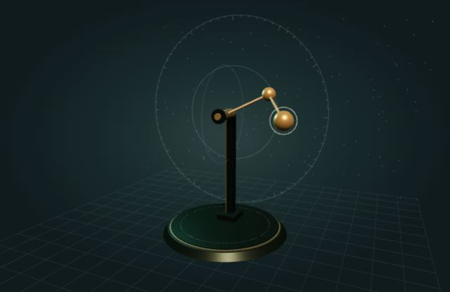
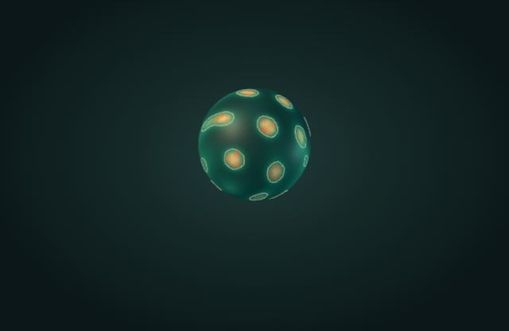
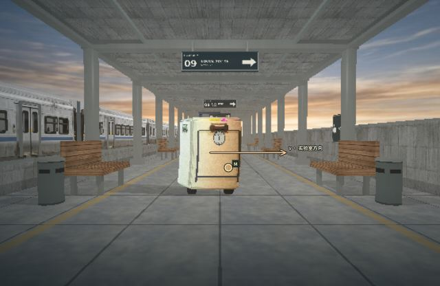

# Stray Papers

一组以**交互、可视化与模拟**探索科学和计算的浏览器项目。各目录是独立实验，不共享运行时；可以按兴趣进入，也可以只运行其中一个。

其中的 [动力学与时空实验室总览](chaos-atlas/overview.html) 将九个可操作的实验连接成一张知识图谱。本文先介绍整个仓库，再给出实验室的启动方法与模型边界。

## 项目导航

| 项目 | 探索内容 | 入口与说明 |
| --- | --- | --- |
| 动力学与时空实验室 · Chaos Lab | 从空间摆、流体和自旋晶格到近光速下的观察 | [总览页](chaos-atlas/overview.html) · [详细说明](chaos-atlas/README.md) |
| Algorithm Lab | 算法、数据结构、创作工具与可视化练习 | [项目说明](algorithm-lab/README.md) |
| Particle Life | 粒子规则、涌现行为与节点图编排 | [项目说明](particle-life/README.md) |
| Schrödinger Workshop | 量子波、量子线路、量子纠错等交互实验 | [项目说明](schrodinger-workshop/README.md) |
| 拓扑学与持续同调 | 拓扑不变量、过滤、条形码与持久图 | [交互页面](particle-life/topology-persistent-homology.html) |
| Aetheris 程序化奇幻星球 | 浏览器中的程序化行星、地形与探索 | [项目说明](procedural-3d-fantasy-planet/README.md) |
| VOLTA-8 Groovebox | 合成器、节拍编排与音频导出 | [项目说明](grooving-Beats/README.md) |
| 深空指挥墙 | 深空任务遥测、警报处置与巡视车模拟 | [项目说明](deep-space-command-wall/README.md) |
| 真实事件三部曲 | 旅行者一号、登月与深海探索的交互故事 | [项目说明](universe_trade/README.md) |

> 仓库中的 HTML 链接在 GitHub 上通常显示源码；要实际操作页面，请下载仓库并在本地浏览器打开，或按对应项目说明启动服务。各项目的依赖和运行方式并不完全相同。

## 动力学与时空实验室

九个全屏工作台，每个实验都提供可操作的场景、控制台和知识卡。总览页可点选知识图谱、查看关联并进入实验；预览图片来自实验静帧，不会在总览中同时运行九个模拟。

| 空间摆 | 球面反应扩散 | 近光速世界 |
| :---: | :---: | :---: |
|  |  |  |

### 九个主实验

| 编号与入口 | 可以动手观察什么 | 核心知识 |
| --- | --- | --- |
| 01 [空间摆](chaos-atlas/index.html) | 拖动摆球、增减级数，对照初始条件微小不同的两条摆链 | 约束运动、初值敏感、理想能量守恒 |
| 02 [相空间图谱](chaos-atlas/attractors.html) | 切换 Lorenz、Rössler、Thomas 系统，比较轨迹和参数 | 相空间、耗散吸引子、敏感依赖 |
| 03 [自由刚体](chaos-atlas/rigid-body.html) | 比较绕不同主轴的旋转，调整恒力的大小、方向和作用点 | 中间轴不稳定、角动量、力矩 |
| 04 [势能地形](chaos-atlas/henon-heiles.html) | 改变 Hénon–Heiles 初态和能量，用探针与庞加莱截面观察轨道 | 哈密顿系统、势能梯度、截面与逃逸 |
| 05 [涡环追逐](chaos-atlas/vortex-rings.html) | 切换涡环初态，观察三维染料、速度切片与涡量 | 不可压缩流、平流、扩散与涡量 |
| 06 [球面图灵斑纹](chaos-atlas/turing-patterns.html) | 调整扩散比、反应参数和球半径，对照不同方程 | 反应扩散、图灵失稳、球面模态 |
| 07 [闪电生长](chaos-atlas/lightning.html) | 移动电极，比较电势场与随机分叉的生长 | 介质击穿、电场反馈、随机生长 |
| 08 [三维自旋晶格](chaos-atlas/ising.html) | 调整温度、外场与结构，查看磁化、关联和相变曲线 | Ising 模型、序参量、临界涨落 |
| 09 [近光速世界](chaos-atlas/relativity.html) | 改变速度与观察者，对照光锥照片、同时几何、颜色和阴影 | 光行时、洛伦兹变换、相对论多普勒 |

第五页控制台可进入**理想涡丝对照**；第七页控制台可进入**局部流注物理对照**。它们不占主章节导航。第八页控制台还包含晶体结构图谱，可将所选几何应用于自旋采样。所有实验与对照页的顶部都有“回到总览”。

### 从一个实验走向另一个实验

- **轨迹与守恒**：理想空间摆和 Hénon–Heiles 地形可用于研究保守运动；Lorenz 的典型吸引子则是耗散系统中的现象。自由刚体的中间轴不稳定并不等于混沌。
- **场与结构**：涡环中的流体场、球面反应扩散中的浓度场和击穿中的电势场，都有空间分布与局部变化，但它们遵循不同的方程和机制。
- **统计与观察**：球面斑纹求解连续浓度，自旋实验则对离散格点做随机采样；蒙特卡洛扫描次数不是实际时间。相对论实验关注的是光到达观察者时的结果，不能直接视为经典摆的高速版本。

### 本地运行

需要现代浏览器。运行实验室本身**不需要 npm、构建步骤、账号或网络连接**；建议用 Python 静态服务器启动，以避免部分浏览器限制本地文件的 Worker：

```sh
# 下载或克隆仓库后，在仓库根目录执行
cd chaos-atlas
python3 serve.py --entry overview.html
```

在本机浏览器打开 **http://127.0.0.1:4173/**。Windows 上如使用 Python 启动器，可执行 `py -3 serve.py --entry overview.html`。按 `Ctrl+C` 停止服务。

- 也可以直接打开 `chaos-atlas/overview.html`：总览和知识图谱无需 JavaScript。部分实验在 `file://` 下受浏览器 Worker 限制，遇到提示时请使用上述服务器。
- `python3 serve.py` 不指定 `--entry` 时仍打开空间摆；原来的 `index.html` 地址没有改变。可以直接访问 `http://127.0.0.1:4173/overview.html` 返回总览。
- 如需在可信局域网中访问，可使用 `python3 serve.py --bind 0.0.0.0 --port 4173 --entry overview.html`，并在其他设备上使用运行服务器的机器地址。此操作会将实验目录暴露给可访问该端口的设备。

### 操作与设备

- 左侧是控制台，右侧是知识卡；侧栏可收起。窄屏会优先为场景留出空间。顶部“实验导航”提供九个主章节的跳转，列表支持滚轮、触摸、滑块和键盘。
- 一般可拖动场景旋转视角、滚轮缩放；模型获得焦点后通常可用方向键旋转、`+` / `−` 缩放、空格播放或暂停。各实验的选点、探针和其他快捷键以页面提示及[详细说明](chaos-atlas/README.md)为准。
- 总览图谱支持鼠标、触摸和键盘方向键；页面可离线使用。实验资源在本地，外部参考文献链接需要联网。
- 三维流体体积显示需要 **WebGL2 和 Worker**；不满足时页面会提示，并在控制台提供涡丝对照。球面反应扩散、闪电、局部流注和自旋采样也需要 Worker；部分场景在 WebGL 不可用时可降级为 Canvas 投影。
- 近光速页面默认使用“流畅优先”模式，并提供可选的 WebGL 高画质。画面细化、拖动和光学选项的耗时取决于设备；较慢设备仍可能卡顿。

### 模型边界

这些是用来学习和比较机制的**数值教学模型**，不是工程验证、天气预报或真实材料测量的替代品。尤其需要留意：

- 涡环画面中的染料是被动示踪标量，不直接等同于涡核；有限网格流体结果不是经过工程验证的 CFD。
- 球面 Gray–Scott 模型中的有限幅种子图案，不一定是线性图灵失稳。势能地形的高度表示势能，不是粒子运动的第三个空间维度。
- 介质击穿模型和小范围流注对照都不是完整的云地闪电或真实空气放电模拟；云层背景和部分发光效果是视觉表现。
- 晶体几何、自旋种类和耦合是教学设定，不自动代表真实材料；有限的随机采样也不保证已经达到平衡。
- 近光速场景只模拟惯性运动，不模拟加速、碰撞或广义相对论。RGB 纹理不能唯一还原真实光谱；可选实测材料曲线仅代表特定样本，场景光照、反射及阴影仍有明确近似。

每个模型的方程、数值方法、边界条件、资料来源和进一步限制，见 [实验室详细 README](chaos-atlas/README.md)。

### 测试

数值及静态服务测试需要 **Node.js 20 或以上和 Python 3**；检出字节完整性测试使用 Git（未安装时跳过）：

```sh
cd chaos-atlas
node --test --test-concurrency=1 tests/*.test.cjs
```

浏览器测试是可选项，需要单独安装 `playwright-core` 并提供 Chromium；安装 `axe-core` 后可运行无障碍检查。例如，在 `chaos-atlas` 目录执行：

```sh
npm install --no-save --no-package-lock playwright-core axe-core
# 将路径替换为本机 Chromium 可执行文件；若已安装 Playwright 管理的 Chromium，可省略环境变量
CHROMIUM_PATH=/path/to/chromium node --test --test-concurrency=1 tests/overview-browser.cjs tests/navigation-browser.cjs
```

完整图形专项还需要可用的 WebGL / WebGL2，测试范围、降级路径及其他命令见[测试说明](chaos-atlas/README.md#测试与许可)。通过有限测试不代表模型具备工程精度。

## 目录结构

```text
stray_papers/
├── chaos-atlas/
│   ├── overview.html           # 九个实验的总览与知识图谱
│   ├── index.html              # 空间摆；其余主实验各有独立 HTML
│   ├── serve.py                # 本地静态服务器，可指定入口
│   ├── *-model.js / *-worker.js # 模型、数值计算与后台任务
│   ├── assets/、data/、vendor/  # 本地素材、数据及第三方资源
│   └── tests/                  # 数值、浏览器和导航测试
├── algorithm-lab/
├── particle-life/              # 粒子生命与拓扑学页面
├── schrodinger-workshop/
├── procedural-3d-fantasy-planet/
├── grooving-Beats/
├── deep-space-command-wall/
└── universe_trade/
```

## 许可与数据

仓库根目录目前没有统一的项目代码许可证声明。第三方资源请分别遵循其许可，例如 [Three.js](chaos-atlas/vendor/THREE-LICENSE.txt)、[Noto Sans SC](chaos-atlas/assets/noto/LICENSE.txt) 和 [DM Sans / Instrument Serif](chaos-atlas/assets/fonts/)。相对论实验中可选 USGS 样本的来源、CC0 信息、校验和与复现方法见[数据说明](chaos-atlas/data/usgs-splib07a/README.md)；CIE 数据相关许可见[许可文件](chaos-atlas/assets/relativity-cie-LICENSE.txt)。

<details>
<summary>English project overview and detailed implementation notes</summary>

A collection of independent, browser-based experiments for learning through interaction, visualization, and simulation. Rather than one application with a shared runtime, each folder is its own small project with its own subject and launch instructions.

| Project | What it explores |
| --- | --- |
| [Algorithm Lab](algorithm-lab/README.md) | Algorithms, data structures, creative coding, and guided practice. |
| [Particle Life](particle-life/README.md) | Emergent particle behavior and node-based simulation. |
| [Schrödinger Workshop](schrodinger-workshop/README.md) | Quantum mechanics, quantum systems, circuits, and error correction. |
| [Topology & Persistent Homology](particle-life/topology-persistent-homology.html) | Topological invariants and persistent homology. |
| [Aetheris](procedural-3d-fantasy-planet/README.md) | A procedural planet and exploration experience. |
| [VOLTA-8 Groovebox](grooving-Beats/README.md) | A browser-based synthesizer and sequencer. |
| [Deep Space Command Wall](deep-space-command-wall/README.md) | An interactive space-mission operations simulation. |
| [Universe Trade](universe_trade/README.md) | Interactive stories about space exploration and the deep sea. |
| [Chaos Lab / The Chaos Atlas](chaos-atlas/README.md) | Nine interactive experiments: a spatial pendulum, a phase-space explorer, rigid-body motion, a Hénon–Heiles landscape, 3D vortex fluid, spherical reaction–diffusion patterns, field-driven 3D dielectric breakdown, a 3D Ising spin lattice, and special-relativistic light-cone optics, with local-streamer and ideal-filament comparison workbenches, plus a crystal-structure atlas whose geometries can be used in the Ising console. |

Start with a project's linked README or page for its specific requirements. The [Chaos Lab overview](chaos-atlas/overview.html) introduces all nine experiments, their connections and model boundaries, with an accessible interactive knowledge map; each workbench has a return link. The original spatial-pendulum URL remains unchanged. Open the [spatial pendulum](chaos-atlas/index.html), [rigid-body rotation](chaos-atlas/rigid-body.html), [phase-space atlas](chaos-atlas/attractors.html), [potential landscape](chaos-atlas/henon-heiles.html), [vortex fluid](chaos-atlas/vortex-rings.html), [spherical Turing patterns](chaos-atlas/turing-patterns.html), [3D lightning growth](chaos-atlas/lightning.html), the [3D Ising lattice](chaos-atlas/ising.html), and the [relativistic light-cone workbench](chaos-atlas/relativity.html); the assets run locally without a build or network connection. Browsers that restrict Workers on local files need the static server described in the project README. The 3D fluid volume requires WebGL2 and a Worker; an idealized filament comparison remains available from the fluid console on unsupported devices. The chapter navigation lists only the nine main experiments; the two comparisons are entered through their parent consoles. The Turing, lightning, local-streamer, and Ising workbenches also need a Worker, but fall back to Canvas rendering when WebGL is unavailable. The relativity workbench defaults to a low-contention, time-sliced Canvas renderer (in a Worker where supported), with an optional WebGL quality mode; direct local-file opening remains available with cooperative main-thread rendering.

The fluid workbench includes computed velocity/vorticity slices, mouse or touch forcing, saved same-simulation-time comparisons, reusable display buffers, and adjustable grid, time step, and pressure-projection iterations. It is an interactive finite-grid teaching model, not validated engineering CFD; see the [numerical and comparison notes](chaos-atlas/README.md#三维流体涡环) for limitations.

The lightning workbench solves a three-dimensional discrete electrostatic field at each stochastic growth step. Voxelized needle/blunt electrodes, event-before/after field slices, grid comparisons and cancellable multi-seed statistics all use computed data. After contact, a separate dimensionless resistor–thermal model displays current and heating; open branches carry no steady DC current in that model. A separate branched, precharged RLC ladder can also replay a finite-speed return-stroke current, voltage and Joule heating under explicitly assumed SI parameters; it is not calibrated to observations or a full electromagnetic/plasma solver. The cloud backdrop, glow, width, and sub-grid bends are visual effects. These are idealized teaching models, not plasma physics or a real-lightning prediction; see the [model notes](chaos-atlas/README.md#三维闪电生长与介质击穿).

The local-streamer comparison in the lightning console computes dimensionless electron/ion drift–diffusion, impact ionization, and a self-consistent Poisson field. Its points and interpolated surface represent density fields, not electron trajectories or optical emission. It is a minimal non-attaching-gas teaching model, not a calibrated model of air or a complete lightning simulation; see its [numerical limits](chaos-atlas/README.md#局部流注电子离子与自洽电场).

The Ising workbench samples either the original simple-cubic lattice or an explicitly selected crystal interaction graph using random-site Metropolis updates. Periodic boundaries or open finite cell blocks, spheres, cylinders and hexagonal prisms change the actual sites and bonds; active species, geometric cutoffs and symmetric species-pair/distance-shell couplings are explicit teaching assumptions. A snapshot analysis computes bond satisfaction, frustrated signed loops, applicable staggered order, connected same-spin clusters, directional correlations and an interactive 3D spin structure factor. Independent temperature scans and multi-size/multi-seed studies sample finite-budget fluctuations and applicable Binder curves, with CSV exports. None of these parameters or patterns is automatically a real material property or measured diffraction. Monte Carlo sweeps are not physical time, and finite, correlated samples do not prove equilibrium, hysteresis or a precise critical temperature. See the [Ising model notes](chaos-atlas/README.md#三维自旋晶格与伊辛相变).

The relativity workbench compares the same laboratory observation event as a past-light-cone photograph and as a simultaneous Lorentz-contracted geometric section; a second experiment compares a moving observer’s aberrated view with a laboratory-stationary observer at the same event. An interactive ray probe reports computed intersections, emission times, directions and the source-to-observer frequency ratio; a pinned ray can be compared with a second sample at the same observation event in a rotatable third-person 3D view of the actual computed paths and emission positions. Five switchable environments—a station, a city street, an industrial corridor, a mountain road and a harbor freight yard—use distinct backgrounds and foreground surfaces (luggage, parcel, equipment panel, wooden crate and moving cargo box), while sharing finite, ray-intersected 3D geometry with the CPU probe. The scene props have actual chamfered bodies and scene-specific finite rest-frame handles, wheels, straps, vents or crate-frame pieces that participate in light and shadow intersections; spheres remain ideal. Station fixtures, four train roofs and the doors, frames and individual windows of the two nearest carriages, vehicles with cylindrical wheels, corridor pipes and nearby triangular slopes are also geometry. The train windows are opaque illustrative surfaces, not transparent glass or a model of the interior. Trees use intersecting masked cards and cylindrical trunks, so their approximate silhouettes participate in ray and shadow intersections without pretending to model individual leaves. The default is β=0.60; the stronger 0.86 and 0.98 presets remain available. The default avoids creating a WebGL context, renders a complete textured preview in short cancellable slices, then reuses its actual rays to refine a clearer still; it does no speculative shader compilation. After a still it builds one cancellable wide-angle ray cache for camera interaction, then becomes idle; on sufficiently capable devices one optional helper Worker can trace disjoint pixel bands for interaction frames, with atomic assembly and single-worker fallback. CPU tracing reuses frame-invariant camera work and avoids allocating temporary BVH-hit and spectral matrices, without reducing the pixel budget or changing the underlying rays. Conservative CPU/GPU envelopes skip unnecessary moving-part intersections while retaining the exact component tests. Decoration hidden behind the initial loading veil is not composited until the first complete frame. Only one frame is in flight; completed worker images are checked against the current revision before presentation, scene changes coalesce to the latest state, and hidden pages stop rendering. Physical-parameter changes hide stale pixels; camera-only changes temporarily reproject rays from the same observation event, with separate sources for comparison halves, and trace a quick matching frame after release before refinement. This approximation can show blur or gaps and is not a new physical frame; probe requests and snapshots wait for a matching view. The default still targets up to about 200,000 pixels in a Worker (120,000 on the main-thread fallback), with lower, time-adaptive budgets while moving. The optional WebGL quality mode uses one shared data-driven program for all five scenes and refines a matching preview—and, when useful, a complete intermediate frame—into a near-screen-resolution still with adaptive, cancellable GPU tiles and visible progress; optional four-sample still antialiasing costs more, and playback remains lower resolution. Small synchronous readbacks prevent GPU work from piling up after the image is reported complete. First-use GPU stalls and long refinement times can still occur. Worker-unavailable and local-file paths use sliced main-thread Canvas rendering. The low-load mode trades resolution and playback frame rate for responsiveness; initial frames and switches can still take time on slower devices. Switchable Doppler colors integrate an explicitly assumed spectrum against CIE color matching functions and use a fixed display tone curve; RGB textures do not determine measured spectra. Direct cast shadows use finite scene intersections and a moving occluder’s retarded position. The default point/directional light gives hard shadows; optional 4, 8 or 16 independent area-light rays estimate penumbrae, with adjustable rectangular lamp width/depth and outdoor angular radius. The real Sun's apparent radius is about 0.27°; the default 4.58° disk is deliberately exaggerated for teaching. More rays cost considerably more, and finite samples can show steps. The selected indoor or harbor light panel follows the adjustable source and its dimensions. An approximate elastic grey-reflection mode separately computes incident and outgoing Doppler factors; textures, ambient light and exposure remain illustrative, not a complete BRDF. Optional fabric, wood and metal wavelength-response curves are explicitly assumed rather than measured, and an optional highlight shoulder cannot restore clipped JPEG detail. Global illumination, general relativity, acceleration and collisions are not simulated. An ideal clock face uses each pixel’s actual surface event; the readout distinguishes a same-laboratory-time proper clock reading from the retarded emission event. A selected rest-frame material point is tracked through visible, off-screen and occluded cases. A 1D-space-plus-time projection shows actual A/B/M events and worldlines, with a slider that retraces A/B at new observation times; a separate 2+1 slice intersects a spatial plane with the past cone and body worldtube, reporting out-of-plane events and finite-sampling limits. Neither is a full four-dimensional diagram. Independent interactive labs compute reflection from an ideal inertial moving mirror and compare a two-ended ideal light clock with secondary-flash arrival times. The default scene objects have distinct dimensions and intersectable parts; three-dimensional velocity direction and a projected velocity arrow, same-event geometry projection, emission-time false color, blackbody/line comparison, adjustable light and retarded-versus-frozen shadows, four-event finite shutter, guided recipes, and local/JSON observation snapshots are available. A separate parameter study holds the event and camera fixed, renders two independently traced images and candidate corner emission-time curves, and exports PNG/JSON for offline reproduction; it is distinct from the two-ray probe. The projected outline is a through-occluder diagram, spectral emitters and lighting are illustrative, and the shutter averages reconstructed linear intensities before display. RGB inputs, clipping, quantization and four temporal samples mean it is not calibrated sensor energy. See the [model and limitations](chaos-atlas/README.md#光抵达的世界狭义相对论光线实验).

Completed stills appear in a keyboard-accessible thumbnail list and restore their saved experiment and exact camera only when the viewport and rendering backend match. A separately budgeted paused-Canvas buffer can reuse exact per-pixel geometry, pre-optics material and matching visibility when optical settings change; a compact low-memory representation reconstructs identical camera rays and preserves Float64 non-axis geometry rather than lowering resolution. Pixels are still re-shaded on the first uncached optical state, and motion, mirrors, nonzero shutter and WebGL bypass it. Matching cached geometry can use shorter interruptible Worker yields on multi-core devices; one/unknown-core and data-saving devices retain the conservative schedule. A CPU-only spatial hierarchy improves new-view tracing without lowering the motion pixel floor. Directional ambient fill and reduced indoor haze are illustrative, not measured global illumination; performance remains device-dependent.

The same-event Doppler on/off split is draggable; its sampled spectrum uses the renderer’s actual pixel input and explicitly assumed (not measured) spectra and material response. A separate animated diagnostic traces a retarded central-light path and terminates at blockers. A second independently moving idealized body can cast and receive shadows; neither acceleration nor collisions are simulated. Approximate roughness, metallic highlights, bounded SDR sky reflection and softened inverse-square point-light falloff are not calibrated PBR/HDR measurements. During fixed-camera playback, reusable static intersections, static-light occluders and matching background radiance are cached while moving bodies and affected shadows are recomputed. Camera drags coalesce excess preview composites without reducing the selected pixel floor or counting reprojection as a physical frame; adjustable motion-quality floors still trade detail against responsiveness, and slower devices can remain below a smooth frame rate. Canvas textures use bilinear interpolation rather than nearest-neighbor sampling, without adding resolution or silhouette antialiasing; its prefiltered road textures and WebGL mipmaps are still different. The selectable playback rate advances visible-page observation time against elapsed time (1× = 0.65 laboratory time units per real second); a slow renderer skips intermediate events, hidden time is excluded, and changing the playback rate does not change β.

The [crystal-structure atlas](chaos-atlas/README.md#晶体结构图谱点阵基元与衍射示意) is a static geometry tool entered from the Ising console. It covers 14 Bravais lattices and 32 idealized or approximate structures, plus editable unit cells and bases. Its committed geometry can be applied to the main sampler; the crystal vectors and chosen boundary then define the actual spin graph, including in independent scans. Selecting a structure does **not** determine which species are magnetic or their real exchange interactions: active spins and couplings are explicit teaching assumptions, not measured material parameters or predictions. The periodic computational cell is not a macroscopic crystal shape; the optional finite shapes are prescribed by the user, not predictions of crystal habit. Geometric cutoff links are not necessarily chemical bonds, and simplified point-scattering intensities are not measured XRD.

</details>
