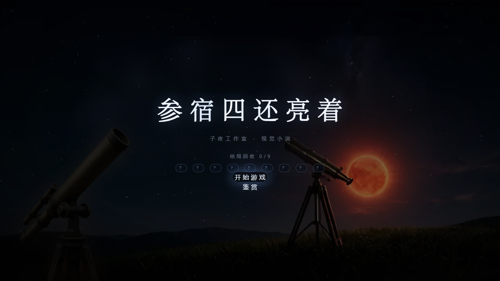
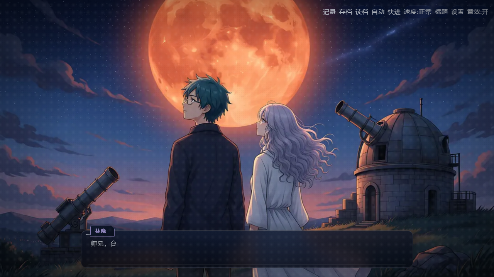
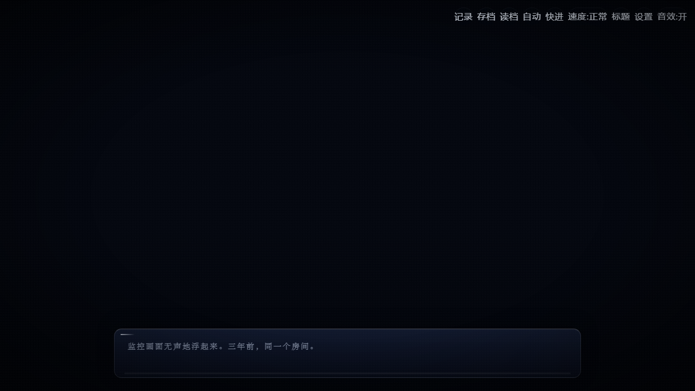

# Betelgeuse Still Shines / 参宿四还亮着

An original Chinese-language visual novel built on a custom zero-dependency
web VN engine. Sci-fi suspense: a late-night observatory, an email scheduled
three years ago by a missing friend, and an AI's question about whether a
memory backup is still the same person.

**Play now**: open `betelgeuse-vn.html` in any browser — fully
self-contained, no server or network needed. For hosted deployments use the
split build (`betelgeuse-vn-lite.html` + packs) — see Builds below.

## Screenshots

Captured from the live engine (1280×720):

| 标题屏                                          | 圆顶汇聚·CG                                           | 记忆潜入                                      |
| ----------------------------------------------- | ----------------------------------------------------- | --------------------------------------------- |
|  |  |  |

More in `docs/screenshots/` (server hall, true ending, plus the original
location renders).

## Story

- 44 scenes, 234 fully voiced dialogue lines, 20 full-screen story CGs,
  30–40 minute playthrough
- 9 endings (3 true + 5 fake + keeper) driven by choice points, flags and a
  hidden double gate — the true ending requires reading her last log entry
- All 234 lines carry per-line emotional TTS prosody (sad/cry/happy/angry
  delivery follows each line's `feel` label); long lines are stitched from
  per-sentence segments with natural pauses
- One-track-per-scene soundtrack: 44 distinct music assignments across the
  story, plus per-location ambient beds and a 5-ambience-layer system
- 100% completion reward: title sky brightens with your progress, a
  true-ending subtitle appears once 还亮着 is reached, and the finale
  unlocks a bonus breakfast epilogue
- Credits roll after each ending; 鉴赏 extras mode: scene gallery, music
  box, sprite viewer, story/ending tree
- 4 characters with 168 sprite renders (5 poses × 8 expressions × gaze
  variants) and per-line gaze direction

## Engine features

- Typewriter text (3 speed settings) with **voice-synced cadence** — lines
  with voice finish typing as the audio ends
- **Skip read text**: skip stops at unread lines by default; scope
  (已读/全部) configurable in settings
- **Autosave** every 8 lines + on page hide, plus a checkpoint on each
  first-time ending collect — the title's 继续游戏 button restores the
  newest point
- Settings panel: master volume, auto-advance delay, skip scope, text size,
  line spacing, high-contrast mode — all persisted
- Hide interface: `H` or right-click lifts the dialog for full-screen CG
  appreciation
- **Rollback**: wheel-up / `PageUp` steps back through shown lines (flags,
  sprites and CG state rewind with it), wheel-down / `PageDown` forward;
  voices stay muted on rolled-back lines
- Fullscreen, 3 save slots + quick save/load, full backlog, `prefers-reduced-motion`
  support throughout
- Line-level direction fx: glitch, shake, dolly (camera push + swell),
  grade, flash, blackout, bigtext (fullscreen black + one line), whisper,
  bounce — plus per-line timed `beats` (fx sequences and mid-line sprite
  changes inside a single textbox)
- CG ken-burns push, dip-to-black transitions, film grain, vignette
- Ambience layer (5 location beds, crossfaded) + one-shot sampled SFX
  (email, door, keyboard, telescope…) on top of the synthesized beds
- Image OP: a skippable 5-slide theme sequence on every new game
- **Post-ending clue nudge**: after the good ending without the true one, the
  title screen offers a low-key reminder that jumps to the story tree's log
  choice point — never auto-enters a scene or touches saves

## Builds

| File                       | Size    | Role                                               |
| -------------------------- | ------- | -------------------------------------------------- |
| `betelgeuse-vn.html`       | ~95 MB  | Full single-file build — plays from disk (file://) |
| `betelgeuse-vn-lite.html`  | ~9.5 MB | Split shell for hosted deployments                 |
| `betelgeuse-bgm-pack.js`   | ~41 MB  | BGM pack, fetched + IndexedDB-cached by the shell  |
| `betelgeuse-voice-pack.js` | ~15 MB  | Voice pack, same loader                            |
| `betelgeuse-bgm2-pack.js`  | ~24 MB  | One-track-per-scene BGM series, same loader        |

The lite deployment set is four files (shell + three packs); packs bust
automatically when their contents change.

Rebuild everything after editing sources:

```bash
python build.py
```

## Files

| File                                   | Role                                                                                                                 |
| -------------------------------------- | -------------------------------------------------------------------------------------------------------------------- |
| `engine.js`                            | VN runtime (vanilla JS, exposes `VN.start(scenario)`)                                                                |
| `scenario.js`                          | The story as pure data (`window.SCENARIO`)                                                                           |
| `art.js` / `props/sprites-data.js`     | Sprite art (SVG fallback + AI-rendered webp)                                                                         |
| `scenes_a.js` / `scenes_b.js`          | Canvas particle-scene renderers                                                                                      |
| `audio.js`                             | `window.VN_AUDIO`: synth beds + ambience layer + sampled SFX/voice playback                                          |
| `props/ai-voice/`                      | TTS pipelines (multi-channel) + voice assets                                                                         |
| `props/ai-sprites/`, `props/ai-audio/` | Asset generation pipelines                                                                                           |
| `docs/`                                | Design docs: foreshadowing ledger, character axes, QA checklist, release plan, voice/BGM audition pages, bgm prompts |
| `build.py`                             | Builds all four artifacts above                                                                                      |
| `index.html`                           | Dev shell (loads the files separately)                                                                               |

## Development docs

- `docs/foreshadowing-ledger.md` — every planted foreshadow and its payoff
- `docs/character-axes.md` — per-character contradiction axes
- `docs/qa-checklist.md` — 9-endings coverage test plan
- `docs/release-plan.md` — itch.io page copy, devlog schedule, AI disclosure
- `docs/voice-review.md` — TTS review pipeline (long lines, special symbols)
- `docs/audition/` — voice timbre + BGM audition pages

## Rebuild / extend

Copy `scenario.js` and edit the `SCENARIO` data structure — scenes, lines,
choices, flags. No engine changes needed. Scene format:

```js
sceneId: {
  bg: "bgId",                                  // optional, persists
  bgm: "trackId",                              // optional music (one track per scene)
  enter: ["flag"],                             // optional flags on entry
  branch: [{ when: "flag", goto: "sceneId" }], // optional gate before lines
  lines: [
    { who: "charId", text: "...", feel: "happy", fx: "bigtext" },
    { narr: "...", cg: "cgId" }
  ],
  choices: [{ text: "...", goto: "sceneId", set: ["flag"] }],
  next: "sceneId"                              // omit for an ending
}
```

Line extras: `fx` (see engine fx list), `beats: [{at, fx}|{at, who, feel, pose}]`,
`gaze: "l"|"r"`, `se: "sfx_key"`, `cg: "cgId"`.

## Real-astronomy hook (2026-11)

VLT captured the clearest image yet of Betelgeuse's elusive companion
"Betelgeuse B" (2-3x Sun mass). Potential sequel/extra-chapter inspiration:
a second consciousness beside the archive.
